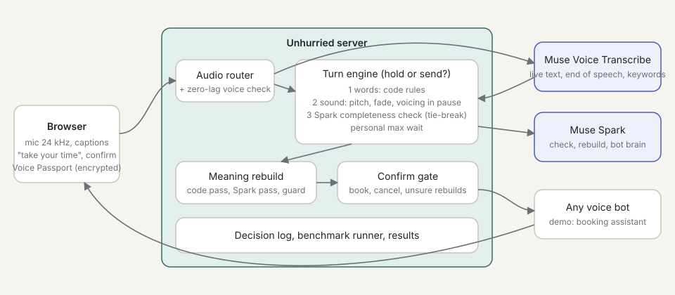

# Unhurried: the turn-taking layer voice AI is missing, proven on the hardest case: stammering.

**On my own free speech (set `real_self`), a normal voice bot replied while I was still talking TBD times; with Unhurried's default engine, TBD times. Invented words: TBD.** Same audio, same measure (cut-offs), streamed through the live server. [Results](bench/results.html).

- Demo video: VIDEO_LINK
- Voice editing on/off, my own voice: [`web/voice-over.html`](web/voice-over.html)
- Everything built so far: [docs/PROJECT_OVERVIEW.md](docs/PROJECT_OVERVIEW.md)

**Built during the hackathon: all code written Oct 28 – Nov 4, 2026.** Meta Global AI Developer Hackathon, Indie track, Theme 1 "Build for Your World".

Measured on stammering only. The same silence-based turn-taking likely affects anyone who pauses; not measured yet.

## Meta models used

| Model | What it does in Unhurried |
| --- | --- |
| **Muse Voice Transcribe** (`muse-voice-transcribe-1.0`) | Live text and end-of-speech as *one signal, not the decision*; keyword biasing per person; Voice Studio transcripts. |
| **Muse Spark 1.3** | Tie-break completeness check (at most 700 ms), meaning rebuild for self-corrections, the learner's tool calls, the assistants. |
| **Muse Spark 1.2 (audio)** | Listens to recordings twice and writes stammers as spoken ("B- B- Binula"). Code checks every cut it suggests. |
| **wav2vec 2.0** (`facebook/wav2vec2-base-960h`, Meta open model) | Places every word and stammer in the audio (our own CTC aligner); an independent check of what was heard. |

---

## What it is

Unhurried sits between a person and any voice bot. It decides when the person has really finished, removes repeated sounds without changing the meaning, and confirms before important actions. It fixes the machine, not the speaker: it never scores, rates or coaches anyone's speech.

**Voice Studio** cleans recordings in the person's own voice: Muse Spark 1.2 listens for stammers, wav2vec 2.0 places each one, code checks the evidence, and the person approves every cut. The output only cuts the original audio; nothing is added.

## The problem

Voice AI is built for fluent speech. A stammer block is often a silent pause, and voice bots treat silence as "finished". They reply in the middle of a sentence, so they cut you off. Repeated sounds ("b-b-book") confuse them, so they mishear the request.

We measured this on Meta's own streaming speech model: with a 3-second pause after "Book a table for", Muse Voice Transcribe's default end-of-speech ended the turn about 0.5 s after the last word ([probe report](scripts/probe_report.md)).

## How it works



1. The browser streams 24 kHz audio to the Unhurried server.
2. The audio router forwards it to **Muse Voice Transcribe** and gets live text and end-of-speech events. A zero-lag audio level check runs on the same audio.
3. The **turn engine** decides on every pause: hold or send.
   - **Words:** code rules. A sentence ending on a linking word ("for", "to", "the"), a cut word ("b-"), a repeated word, a filler or no words yet is unfinished, so it holds.
   - **Voice:** our own audio code on the last 0.5 s before the pause: pitch direction, volume fade, and voicing inside the pause. If words and voice both say finished, the turn is sent at once, with no model call.
   - **Muse Spark** breaks ties: "is this a complete request?" Checks start early on live text; at the pause the engine waits at most 700 ms, then decides with words and voice (logged as `spark_late`).
   - **Personal max wait:** from the person's pauses inside sentences (90th percentile + 1 s, 2 to 6 s).
   - While holding, the screen shows "Take your time". There is no timer or countdown.
4. The **meaning rebuild** joins repeated sounds and words and removes fillers in code. Muse Spark resolves self-corrections ("two, no, three" becomes "three"). A **no-new-content guard** checks that every number, day, time, name and word in the clean text was actually said. If not, Unhurried asks the person.
5. The **confirm gate** shows one line ("Book a table for 2 at 7 PM on Friday?") with Yes / Change before booking or cancelling.
6. The bot gets the clean sentence. The person can always tap "show what I said".

The benchmark streams recordings through the same server, so the numbers come from the real pipeline.

## Run it (Windows PowerShell)

```powershell
python -m pip install -r requirements.txt
Copy-Item .env.example .env       # then add your META_API_KEY to .env
python -m uvicorn server.main:app --port 8000
```

- Studio (live): http://127.0.0.1:8000
- Voice Studio: http://127.0.0.1:8000/web/voice-studio.html
- Voice-over player (editing on/off): http://127.0.0.1:8000/web/voice-over.html
- Split-screen clip demo: http://127.0.0.1:8000/web/demo.html
- Results: http://127.0.0.1:8000/bench/results.html (after `python bench/report.py`)
- Tests: `python -m pytest`

Benchmark:

```powershell
python bench/import_studio.py                      # add live Voice Studio recordings to set real_self
python bench/run_bench.py --set real_self --configs baseline,unhurried,sound_spark
python bench/run_bench.py --set synthetic --configs baseline,unhurried,sound_spark
python bench/report.py                             # writes bench/results.html, one table per set
```

## Results

Two sets, never mixed. Every number below comes from a file in `bench/results/`.

**Cut-offs**: a turn was actually sent to the bot before the real end of speech (the bot replied while the person was still talking). **Early end-of-speech**: Voice Transcribe's end-of-speech signal fired during a pause inside the speech; it is a signal, not a reply.

### Real: my own voice (`real_self`)

TBD: filled from the results file after the run.

### Synthetic (`synthetic`)

Run on Oct 28, 2026 ([results file](bench/results/20261028_141053.json)). 24 clips (16 with silent blocks, repeats, fillers or a self-correction; 8 fluent), made with Windows text-to-speech. These test the pipeline, not real stammered speech.

| Turn engine | Cut-offs (clips with pauses) | Understood | Added delay on fluent speech (median / p95) |
| --- | --- | --- | --- |
| Normal voice bot (baseline) | **9 / 16** | 23 / 24 | – |
| Words only | 0 / 15 * | 21 / 23 * | 0.32 s / 0.61 s |
| Words + Spark check | 1 / 16 | 24 / 24 | 0.72 s / 0.90 s |
| Words + voice | 3 / 16 | 23 / 24 | 0.04 s / 0.29 s |
| Words + voice + Spark | 2 / 16 | 23 / 24 | 0.04 s / 0.40 s |

\* One run in this setup failed (connection closed); it is left out, not counted as a success.

- **Invented content: 0** turns in every setup.
- **Early end-of-speech** fired inside 10 of the 16 clips with pauses in the baseline run.
- Spark's completeness check was correct on 28 of 29 decision points (median 1.37 s per call) ([file](bench/results/models_20261028_141053.json)).

## Voice Passport and learner

The personal profile is encrypted in the browser (AES-256-GCM, key from a passphrase via PBKDF2-SHA-256 with 600,000 rounds). The server stores only the locked blob and cannot read it. At session start the browser sends only what the session needs. The learner suggests setting changes you approve; code limits every suggestion (max wait 2–6 s, at most 1 s per step). See [web/privacy.html](web/privacy.html).

Honest limit: the word list is sent to Voice Transcribe during a session for keyword biasing, and the text of each turn is sent to Muse Spark.

## Ground rules

- **Not a speech coach or a medical tool.** Unhurried changes how the AI listens. It never scores, rates or tracks a person's speech, and never gives speaking tips.
- **Measure only the AI:** cut-offs, understanding, added delay, invented content.
- **Privacy:** live audio is not stored. Voice Studio keeps a recording on the local machine until the person deletes it.
- **Consent:** only the builder's own voice and synthetic voices are public. Volunteers' audio stays private ([form](docs/consent_form.md)).
- **No SEP-28k:** its non-commercial license conflicts with the hackathon's submission terms.

## Honest limits

- The sets are small. Counts are shown, not only percentages.
- Synthetic clips are text-to-speech with silent pauses, not real stammered speech.
- Muse Spark takes about 1–2 s per call, longer than its 700 ms budget, so it often arrives late and the engine decides with words and voice.
- Muse Spark does not hear a recording the same way twice; in Voice Studio the person reviews the cuts and can add or undo any of them.
- Both speech models mishear some words of a strong accent; Voice Studio's audio is only cuts of the real voice, but the text shown can contain misheard words.

## Next steps

- **Muse Glimmer** comparison (`bench/compare_models.py` is ready; not run, no host configured).
- SAM 3.1 sight signal (opt-in camera), Muse Spark Open audio tie-breaker, more real recordings.
